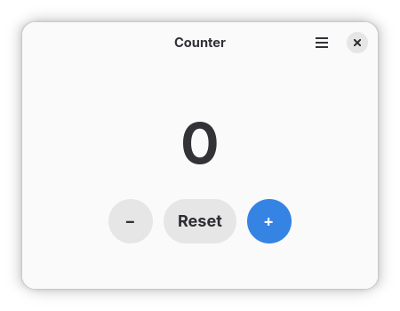

# Tally

Tally is a GNOME application for keeping count in a state with a core set of features which include incrementation, decrementation and reseting a number in a state with a pleasant user interface and user-friendly controls.

<p align="center">
  
</p>

## Getting Started

Download the latest release from
[GitHub releases](https://github.com/keinsell/tally/releases), with preference towards `tally-vX.Y.Z-x86_64.flatpak` artifact which is intented to be run on any major distribution of linux operating system.
```sh
flatpak install --user tally-vX.Y.Z-x86_64.flatpak
flatpak run com.keinsell.Tally
```

This builds the manifest in `build-aux/` and exports `tally-<arch>.flatpak`
in the project root. After changing `Cargo.lock`, regenerate the vendored
Flatpak cargo sources so the offline build keeps working — see
[CONTRIBUTING.md](CONTRIBUTING.md).

## Credits

Application icon artwork by Victoria Lacroix, taken from
[Tally](https://codeberg.org/bragefuglseth/tally) and used under the terms of
the GNU General Public License v3.0 or later.
